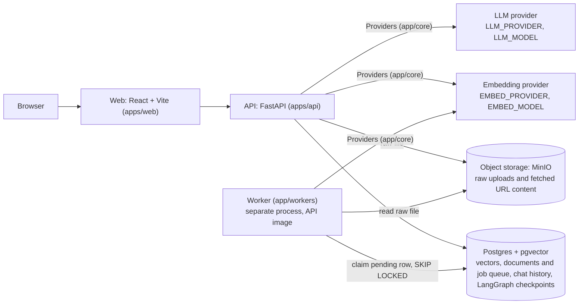
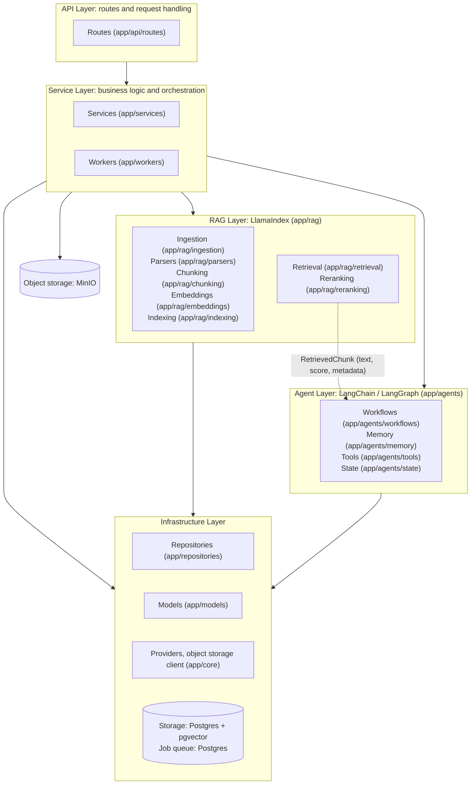
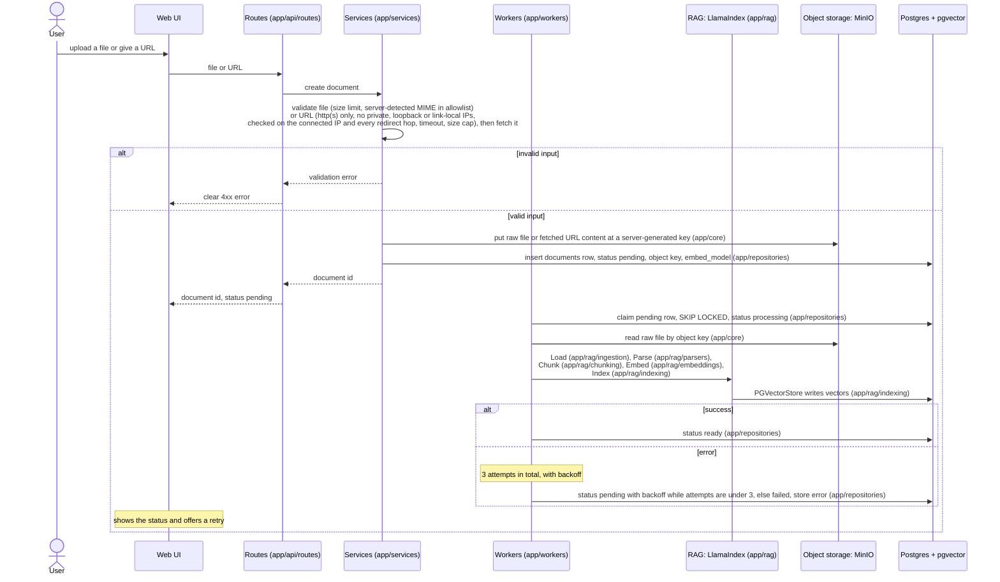
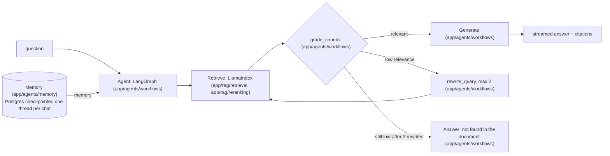

# Architecture diagrams

Source of truth: [overview.md](overview.md), [ADR 0001](../decisions/0001-stack-and-scope.md) and [ADR 0002](../decisions/0002-object-storage-and-job-queue.md). These diagrams only restate them.

## Containers

Postgres holds structured state, vectors and the job queue; MinIO holds the raw files. The API never runs ingestion: it stores the file, inserts a `pending` row, and the worker process claims it. Providers are resolved only in `app/core/providers.py`, the only place that imports vendor SDKs.

## Module layering

Arrows connect layers, not modules, and each one means "calls"; every arrow points down, and nothing calls upward. Routes only handle requests: they never run retrieval or touch the vector store, and go through services instead. The dotted edge is the only thing that crosses between rag and agents, and it carries plain data. `app/rag` never touches object storage; workers pass it the bytes and the MIME type as plain data. Workers run as their own process and are never called by routes; the API only inserts a `pending` row.

## Ingestion

Status moves `pending → processing → ready | failed`. Services validate the input before any file or row is written; URL validation and fetch live together in `app/services`. Routes only pass the request to services.

## Chat

[Runtime self-healing rules](overview.md#runtime-self-healing-rules)
