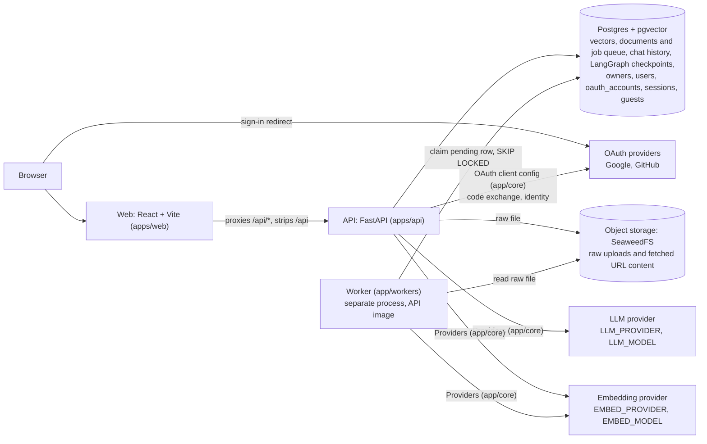
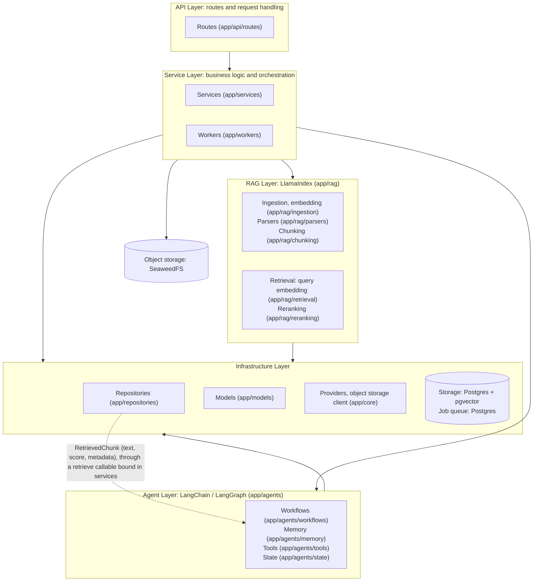
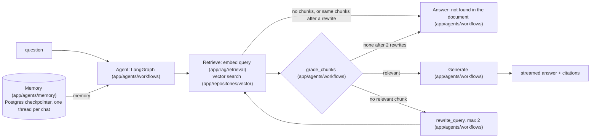
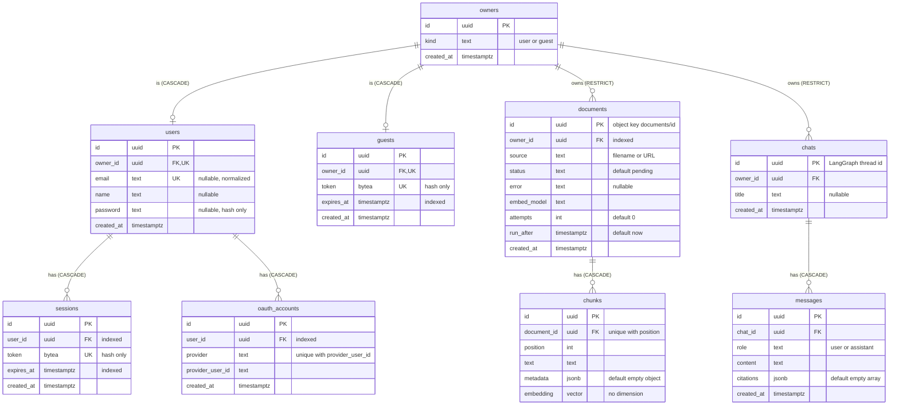

# Architecture diagrams

Source of truth: [overview.md](overview.md), [ADR 0001](../decisions/0001-stack-and-scope.md), [ADR 0002](../decisions/0002-object-storage-and-job-queue.md) and [ADR 0003](../decisions/0003-guest-and-user-accounts.md). These diagrams only restate them.

## Containers



Postgres holds structured state, vectors and the job queue; SeaweedFS holds the raw files. The API never runs ingestion: it stores the file, inserts a `pending` row, and the worker process claims it. Providers are resolved only in `app/core/providers.py`, the only place that imports vendor SDKs. OAuth providers are external: the browser is redirected to them to sign in, and the API exchanges the code and reads the identity server-side.

## Module layering



Arrows connect layers, not modules, and each one means "calls"; every arrow points down, and nothing calls upward. Routes only handle requests: they never run retrieval or touch the vector store, and go through services instead. Rag and agents never call each other: services embed the query through rag, search through repositories, and pass agents a `retrieve` callable. The dotted edge is the only data that reaches agents from retrieval, and it is plain data ([ADR 0007](../decisions/0007-retrieval-and-corrective-rag.md)). `app/rag` never touches object storage; workers pass it the bytes and the MIME type as plain data. Workers run as their own process and are never called by routes; the API only inserts a `pending` row.

## Ingestion

```mermaid
sequenceDiagram
  actor User
  participant UI as Web UI
  participant R as Routes (app/api/routes)
  participant S as Services (app/services)
  participant W as Workers (app/workers)
  participant RAG as RAG: LlamaIndex (app/rag)
  participant OS as Object storage: SeaweedFS
  participant DB as Postgres + pgvector
  User->>UI: upload a file or give a URL
  UI->>R: file or URL
  R->>S: create document for the owner (guest or user)
  S->>S: check the tier's document cap, then validate the file<br/>(tier size limit, server-detected type in the tier allowlist)<br/>or URL (http(s) only, no private, loopback or link-local IPs,<br/>checked on the connected IP and every redirect hop, timeout, tier size cap), then fetch it
  alt invalid input
    S-->>R: validation error
    R-->>UI: clear 4xx error
  else valid input
    S->>OS: put raw file or fetched URL content at documents/<id>, a server-generated id (app/core)
    S->>DB: insert documents row with that id, owner_id, status pending, embed_model (app/repositories)
    S-->>R: document id
    R-->>UI: document id, status pending
    W->>DB: claim pending row, SKIP LOCKED, status processing (app/repositories)
    W->>OS: read raw file at documents/<id> (app/core)
    W->>RAG: Parse (app/rag/parsers), Chunk (app/rag/chunking),<br/>Embed (app/rag/ingestion)
    RAG-->>W: EmbeddedChunk list (text, embedding, metadata)
    alt success
      W->>DB: replace the document's chunks (app/repositories/vector),<br/>status ready, embed_model used (app/repositories)
    else error
      Note over W: 3 attempts in total, with backoff;<br/>an IngestionError (unusable input) fails at once
      W->>DB: status pending with backoff while attempts are under 3, else failed, store error (app/repositories)
    end
    Note over UI: shows the status and offers a retry
  end
```

Status moves `pending → processing → ready | failed`. Services validate the input before any file or row is written; URL validation and fetch live together in `app/services`. Routes only pass the request to services.

## Chat



## Database schema



- CHECK constraints: `owners.kind` is `user` or `guest`; `users.email` equals `lower(btrim(email))`, so its unique constraint holds on the normalized form; `documents.status` is `pending`, `processing`, `ready` or `failed`, and `failed` requires a non-empty `error`; `messages.role` is `user` or `assistant`.
- The partial index `ix_documents_pending_run_after` (on `run_after`, `WHERE status = 'pending'`) serves the worker's job-queue claim ([ADR 0002](../decisions/0002-object-storage-and-job-queue.md)). `chats` and `messages` have `(owner_id, created_at)` and `(chat_id, created_at)` indexes for listing.
- `RESTRICT` on `documents` and `chats` blocks deleting an owner that still owns either, so a cascade never drops rows whose vectors, objects or checkpoints still exist. The guest purge deletes those first, then the rows, then the owner ([ADR 0003](../decisions/0003-guest-and-user-accounts.md)).
- The object key is not a column: it is `documents/<id>`, derived from the document's `id`.
- `chunks.embedding` has no dimension, so changing `EMBED_MODEL` needs no migration; retrieval filters on `documents.embed_model`. There is no HNSW index for the MVP ([ADR 0006](../decisions/0006-vector-store.md)).
- The LangGraph checkpoint tables live in the same database, but outside Alembic and this diagram.

[Runtime self-healing rules](overview.md#runtime-self-healing-rules)
