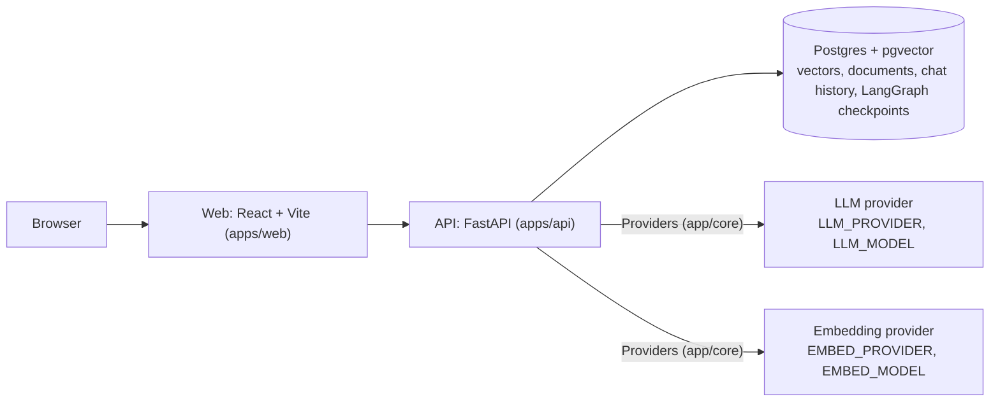
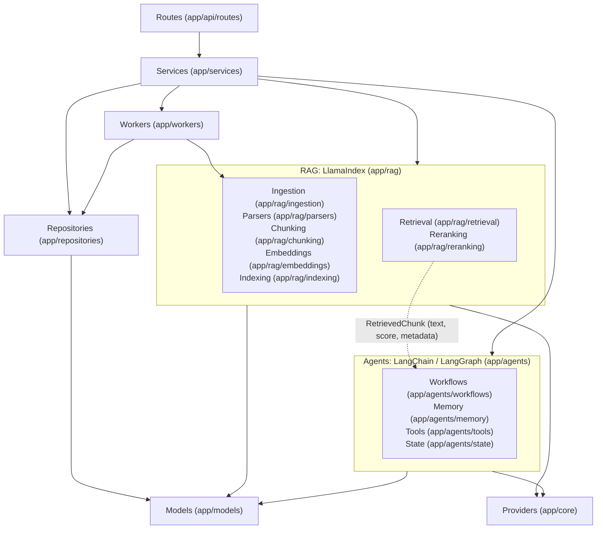
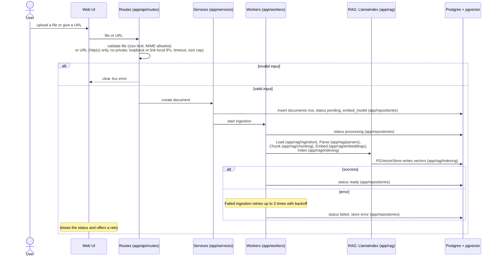
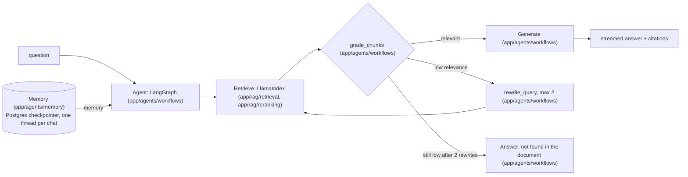

# Architecture diagrams

Source of truth: [overview.md](overview.md) and [ADR 0001](../decisions/0001-stack-and-scope.md). These diagrams only restate them.

## Containers

One Postgres database holds all state. Providers are resolved only in `app/core/providers.py`, the only place that imports vendor SDKs.

## Module layering

Solid arrows mean "calls", and nothing calls upward. The dotted edge is the only thing that crosses between rag and agents, and it carries plain data.

## Ingestion

Status moves `pending → processing → ready | failed`. Validation happens at the boundary, before any row is written.

## Chat

[Runtime self-healing rules](overview.md#runtime-self-healing-rules)
