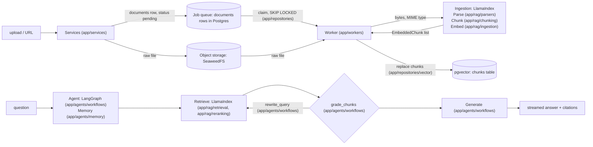

# Architecture

**Users:** two tiers. Guests get a private, expiring session tied to an HTTP-only cookie, with no account. Registered users sign in with email and password, Google or GitHub. Each document and chat belongs to exactly one owner, a guest or a user ([ADR 0003](../decisions/0003-guest-and-user-accounts.md)). Scope, limits per tier and acceptance criteria: [requirements.md](requirements.md).

## Pipeline

More diagrams: [diagrams.md](diagrams.md).

| Stage | Owner | Module |
|---|---|---|
| Validate against the owner's tier limits, fetch the URL, store the raw file, queue the job | Services: S3 client from `app/core`, `documents` row via `app/repositories` | `app/services` |
| Claim the job, ingest, track status | Worker loop, `SKIP LOCKED` claim query, then parse, chunk and embed through one entry point | `app/workers`, `app/repositories`, `app/rag/ingestion` |
| Parse (PDF, DOCX, HTML, text) | pypdf and the stdlib (`zipfile`, `xml.etree`, `html.parser`); a LlamaIndex `Document` is only the container | `app/rag/parsers` |
| Chunk | LlamaIndex node parsers | `app/rag/chunking` |
| Embed | LlamaIndex embedding model from `app/core/providers.py`, called from ingestion; `app/rag/embeddings` is still an empty placeholder | `app/rag/ingestion` |
| Index | `chunks` table, pgvector `Vector` column via SQLAlchemy ([ADR 0006](../decisions/0006-vector-store.md)) | `app/repositories/vector` |
| Retrieve, rerank | LlamaIndex retrievers and postprocessors | `app/rag/retrieval`, `app/rag/reranking` |
| Workflow: grade, rewrite, generate | LangGraph + LangChain chat models | `app/agents/workflows` |
| Memory | LangGraph Postgres checkpointer | `app/agents/memory` |
| Tools, state | LangChain tools, typed state | `app/agents/tools`, `app/agents/state` |
| Model selection | Provider factory reading `Settings` | `app/core/providers.py` |

**Boundary:** `app/rag/retrieval` returns `list[RetrievedChunk]`, where each item holds `text`, `score` and `metadata` (source, page, document_id). `app/agents` wraps retrieval as a tool or graph node. LlamaIndex objects never leave `app/rag/`.

**Auth:** routes resolve the session or guest cookie to one `owner_id` through `app/services`, and pass it down. Every document and chat query in `app/repositories` that routes or services call filters on `owner_id`; only the worker queries (claim, startup reset, status updates, object-key reads, purge) are exempt, and only `app/workers` calls them. Retrieval receives only the owner's document ids as plain data, so `app/rag` and `app/agents` never see users, guests or cookies. `app/api/middleware` rejects state-changing requests whose `Origin` is not the origin of `PUBLIC_BASE_URL`. The browser uses one origin, `PUBLIC_BASE_URL`: the web server (Vite in dev, the web container in production) proxies `/api/*` to the API and strips the prefix, so cookies are first-party and no CORS is needed. OAuth provider entries live in `app/core`, which is the only place that holds their client config.

**Layering:** `api/routes` → `services`; `services` and `workers` (own process) → (`rag` | `agents` | `repositories` | `core`) → `models`. Routes never call `workers`. Nothing calls upward.

**DB access:** request code uses async SQLAlchemy on psycopg 3, with one `AsyncSession` per request from `get_db()` in `app/core/db.py`. Services commit; the dependency only closes. On Windows, async entrypoints use `loop_factory=asyncio.SelectorEventLoop`. Alembic stays sync ([ADR 0005](../decisions/0005-request-db-access.md)).

## Providers
`app/core/providers.py` builds the models from `Settings` (`LLM_PROVIDER`/`LLM_MODEL`, `EMBED_PROVIDER`/`EMBED_MODEL`) ([ADR 0004](../decisions/0004-provider-factory.md)):
- `get_chat_model(settings) -> BaseChatModel`: `anthropic`, `openai` or `ollama`.
- `get_embed_model(settings) -> BaseEmbedding`: `openai` or `ollama`.

It returns plain models, not wrapped, so agents can call `.with_structured_output` or `.bind_tools`. A missing API key raises `ValueError` naming the setting, never its value. Callers use `providers.get_chat_model(settings)` through the module, so tests mock models here.

**Single exception to the hard rule:** `providers.py` is the only module that imports vendor model integrations. It imports LangChain and LlamaIndex model classes only to construct them. No other code in `app/core` imports either framework.

**Constraint:** changing the embedding model or its dimensions requires a re-index. Store `embed_model` with each document and refuse to query across mismatched models.

## Runtime self-healing rules
Every piece of app code must follow these rules.

1. **Retry transient failures.** `app/core/providers.py` sets the SDKs' built-in retries and a 60 s timeout: chat models get `max_retries=2` (3 attempts in total), and the OpenAI embedding gets `EMBED_MAX_RETRIES = 1` (at most 2 requests, because LlamaIndex applies it twice). They retry connection errors, 408, 409, 429 and 5xx, never other 4xx. Do not add `.with_retry` on top: it retries every exception by default and stacks on the SDK retries. Ollama runs locally and has no retry.
2. **Fall back across providers.** When a second provider is configured, build the chat model as `primary.with_fallbacks([secondary])`.
3. **Corrective RAG.** The LangGraph flow is `retrieve → grade_chunks → (generate | rewrite_query → retrieve)`.
   - The grader scores relevance.
   - On low relevance, it rewrites the query, at most 2 times.
   - After that, it answers "not found in the document" instead of guessing.
4. **Grounded answers only.** Every answer cites the chunks it used. When retrieval returns nothing, say so; never answer from model memory.
5. **Ingestion status.** Each document moves through `pending → processing → ready | failed` and stores an `error` field.
   - One worker process runs the jobs: `make worker` (`python -m app.workers.ingestion`), or the compose `worker` service. It takes a Postgres advisory lock at startup and exits if another worker holds it. When the database drops, it reconnects and takes the lock again before it claims another job ([ADR 0006](../decisions/0006-vector-store.md)).
   - Provider, object storage and timeout errors get 3 attempts in total, with a backoff of 30 s, then 2 min. After a failure, the row goes back to `pending` while `attempts < 3`, and becomes `failed` with its error after that.
   - An `IngestionError` (unusable input, such as an unreadable or password-protected file, or no readable text) sets `failed` at once, with no retry.
   - Each job runs under a 600 s timeout, which counts as a failed attempt.
   - `documents.error` is shown to users, so it holds only a fixed user-safe message (the `IngestionError` text, "Ingestion timed out." or "Ingestion failed."), never the raw exception. The worker logs the full exception with the document id.
   - Retries re-read the raw file from object storage. At startup, the single worker sets `processing` rows with `attempts >= 3` to `failed` with the error "worker stopped during the last attempt", and resets every other `processing` row to `pending` ([ADR 0002](../decisions/0002-object-storage-and-job-queue.md)).
   - The UI shows the status and offers a retry. A manual retry (`POST /documents/{id}/retry`) or re-index resets only a `failed` or `ready` row and clears its `error`; a `pending` or `processing` row is not touched, and the API returns 409 Conflict ([ADR 0002](../decisions/0002-object-storage-and-job-queue.md)).
6. **Fail safe at the boundary.**
   - Validate uploads with the owner's tier size limit and type allowlist, checked on the server-detected type, never the client `Content-Type` header ([requirements.md](requirements.md)).
   - Validate URLs: http(s) only, no private, loopback or link-local IPs (SSRF), with a timeout and the tier's size cap. Check the IP actually connected to and every redirect hop (or refuse redirects). Validation and fetch live together in `app/services`.
   - Return clear 4xx errors.

## Data (Postgres + object storage)
State lives in Postgres (structured data, vectors, the job queue) and object storage (raw files). See [ADR 0002](../decisions/0002-object-storage-and-job-queue.md).
Tables, columns and keys: [Database schema](diagrams.md#database-schema).

- `documents`: id, owner_id, source (filename or URL), status, error, embed_model, attempts, run_after, created_at
  - `owner_id` points to `owners`; a guest-to-user migration only rewrites it ([ADR 0003](../decisions/0003-guest-and-user-accounts.md)).
  - The row is the ingestion job. The worker claims it with `SELECT ... FOR UPDATE SKIP LOCKED`.
  - The object key is not stored: it is `documents/<id>`, derived from the row's `id`, which the service generates before the object write. It never comes from the filename, URL or any user input; the original filename or URL is kept only in `source`.
- Object storage (SeaweedFS, or any S3-compatible store): one object per document at `documents/<id>`, the raw upload or fetched URL content, with the server-detected MIME type as its `Content-Type`
- `chunks`: id, document_id (deleted with its document), position (unique per document), text, metadata (JSON), embedding (`vector` with no dimension, so retrieval filters on `documents.embed_model`). Created in Alembic; owner isolation comes from the join to `documents` ([ADR 0006](../decisions/0006-vector-store.md)).
- `chats`: id (also the LangGraph thread id), owner_id, title, created_at
- `messages`: id, chat_id (deleted with its chat), role (`user` or `assistant`), content, citations (JSON, default `[]`), created_at. This is the chat history the API returns.
- LangGraph checkpointer tables: one thread per chat
- Accounts ([ADR 0003](../decisions/0003-guest-and-user-accounts.md)): `owners` (one row per guest or user), `users`, `oauth_accounts`, `sessions` (token hash, expiry), `guests` (token hash, expiry)
