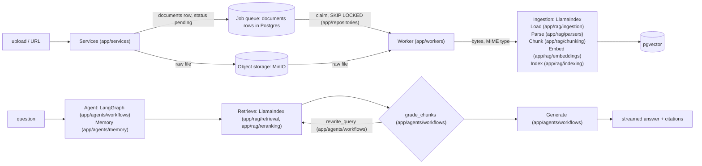

# Architecture

## Pipeline

More diagrams: [diagrams.md](diagrams.md).

| Stage | Owner | Module |
|---|---|---|
| Validate, fetch the URL, store the raw file, queue the job | Services: S3 client from `app/core`, `documents` row via `app/repositories` | `app/services` |
| Claim the job, ingest, track status | Worker loop, `SKIP LOCKED` claim query, LlamaIndex readers | `app/workers`, `app/repositories`, `app/rag/ingestion` |
| Parse (PDF, DOCX, HTML) | LlamaIndex readers | `app/rag/parsers` |
| Chunk | LlamaIndex node parsers | `app/rag/chunking` |
| Embed | Provider factory, then LlamaIndex embedding | `app/rag/embeddings` |
| Index | LlamaIndex `PGVectorStore` | `app/rag/indexing` |
| Retrieve, rerank | LlamaIndex retrievers and postprocessors | `app/rag/retrieval`, `app/rag/reranking` |
| Workflow: grade, rewrite, generate | LangGraph + LangChain chat models | `app/agents/workflows` |
| Memory | LangGraph Postgres checkpointer | `app/agents/memory` |
| Tools, state | LangChain tools, typed state | `app/agents/tools`, `app/agents/state` |
| Model selection | Provider factory reading `Settings` | `app/core/providers.py` |

**Boundary:** `app/rag/retrieval` returns `list[RetrievedChunk]`, where each item holds `text`, `score` and `metadata` (source, page, document_id). `app/agents` wraps retrieval as a tool or graph node. LlamaIndex objects never leave `app/rag/`.

**Layering:** `api/routes` → `services`; `services` and `workers` (own process) → (`rag` | `agents` | `repositories` | `core`) → `models`. Routes never call `workers`. Nothing calls upward.

## Providers
`app/core/providers.py` builds the LLM and the embedding model from `LLM_PROVIDER`/`LLM_MODEL` and `EMBED_PROVIDER`/`EMBED_MODEL`. It is the only place that imports vendor SDKs.

**Constraint:** changing the embedding model or its dimensions requires a re-index. Store `embed_model` with each document and refuse to query across mismatched models.

## Runtime self-healing rules
Every piece of app code must follow these rules.

1. **Retry transient failures.** Wrap LLM and embedding calls with `.with_retry(stop_after_attempt=3, wait_exponential_jitter=True)`. Retry only on timeouts, 429 and 5xx responses, never on 4xx validation errors.
2. **Fall back across providers.** When a second provider is configured, build the chat model as `primary.with_fallbacks([secondary])`.
3. **Corrective RAG.** The LangGraph flow is `retrieve → grade_chunks → (generate | rewrite_query → retrieve)`.
   - The grader scores relevance.
   - On low relevance, it rewrites the query, at most 2 times.
   - After that, it answers "not found in the document" instead of guessing.
4. **Grounded answers only.** Every answer cites the chunks it used. When retrieval returns nothing, say so; never answer from model memory.
5. **Ingestion status.** Each document moves through `pending → processing → ready | failed` and stores an `error` field.
   - Ingestion gets 3 attempts in total, with backoff between them, matching `stop_after_attempt=3`. After a failure, the row goes back to `pending` while `attempts < 3`, and becomes `failed` with its error after that.
   - Retries re-read the raw file from object storage. At startup, the single worker sets `processing` rows with `attempts >= 3` to `failed` with the error "worker stopped during the last attempt", and resets every other `processing` row to `pending` ([ADR 0002](../decisions/0002-object-storage-and-job-queue.md)).
   - The UI shows the status and offers a retry. A manual retry or re-index resets only a `failed` or `ready` row; a `pending` or `processing` row is not touched, and the API returns 409 Conflict ([ADR 0002](../decisions/0002-object-storage-and-job-queue.md)).
6. **Fail safe at the boundary.**
   - Validate uploads with a size limit and a MIME allowlist, checked on the server-detected type, never the client `Content-Type` header.
   - Validate URLs: http(s) only, no private, loopback or link-local IPs (SSRF), with a timeout and a size cap. Check the IP actually connected to and every redirect hop (or refuse redirects). Validation and fetch live together in `app/services`.
   - Return clear 4xx errors.

## Data (Postgres + object storage)
State lives in Postgres (structured data, vectors, the job queue) and object storage (raw files). See [ADR 0002](../decisions/0002-object-storage-and-job-queue.md).

- `documents`: id, source (filename or URL), status, error, embed_model, object_key, attempts, run_after, created_at
  - The row is the ingestion job. The worker claims it with `SELECT ... FOR UPDATE SKIP LOCKED`.
  - `object_key` is `documents/<uuid>`, built by the server from a UUID it generates before the object write. It never comes from the filename, URL or any user input; the original filename or URL is kept only in `source`.
- Object storage (MinIO, or any S3-compatible store): one object per document at `object_key`, the raw upload or fetched URL content, with the server-detected MIME type as its `Content-Type`
- Vector table: managed by LlamaIndex `PGVectorStore`, with `document_id` in its metadata
- LangGraph checkpointer tables: one thread per chat
